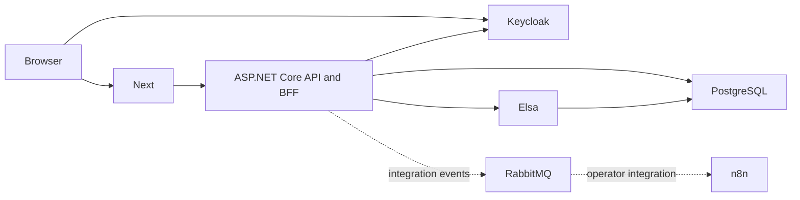
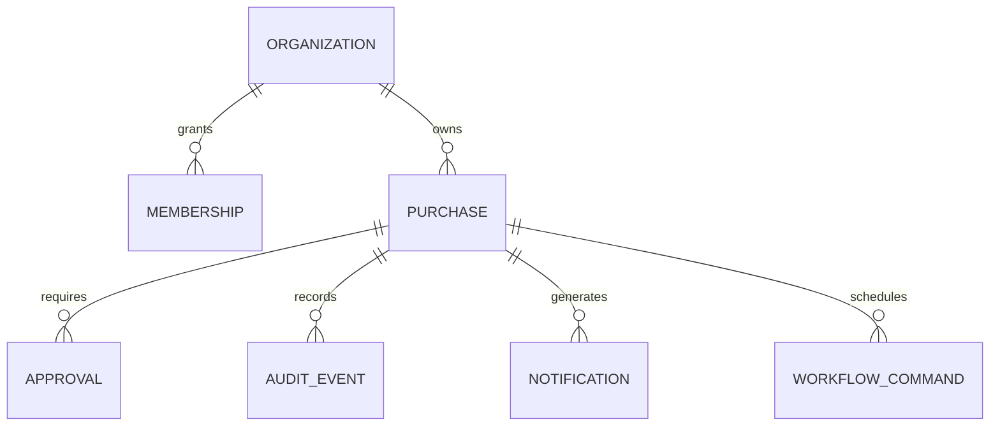

# Architecture

FlowOps starts as a modular monolith. The web server renders the workspace and forwards same-origin authentication and API traffic to ASP.NET Core. Keycloak owns identity. PostgreSQL owns organization membership and application records. Elsa owns workflow execution.

The web boundary uses a server-managed session and same-origin write protection. The API also supports Keycloak bearer tokens with a FlowOps audience. Keycloak subjects identify users. Organization membership in the application database grants tenant access.

Purchase requests, approval tasks, audit entries, and notifications use organization-scoped keys. Commands update domain state with optimistic concurrency. The purchase workflow uses a stable instance ID and durable bookmarks. A PostgreSQL command queue bridges the transaction boundary between business state and Elsa. Workflow callbacks must be idempotent across replay.

## Data model

See [TASKS.md](TASKS.md) for implementation and verification status.
