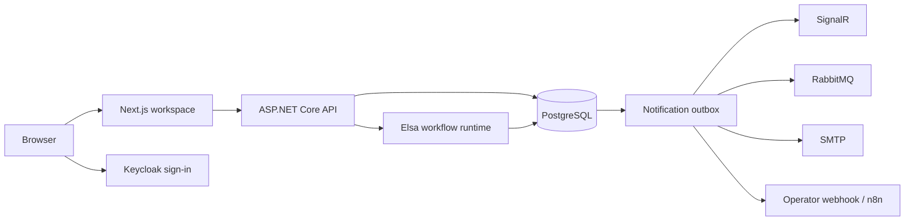

# FlowOps

**A purchase approval workspace for organizations that need to see who owns the next step, which rules ran, and how a decision was made.**

[](https://github.com/cevikburak1/flowops/actions/workflows/verify.yml)

[Run locally](#run-locally) · [Try the demo](#try-the-demo) · [How it works](#how-it-works) · [Documentation](#documentation)

## From request to decision

1. **Submit.** An employee enters an amount, category, description, and priority.
2. **Route.** FlowOps selects the employee’s manager, team lead, or department lead. The published workflow can send higher-value requests to finance.
3. **Decide.** Reviewers work from **My tasks**, with a due date and a record of each decision. Administrators can reassign an open task.
4. **Trace.** The request retains its published workflow version. The execution canvas shows the steps Elsa ran, and the operations report summarizes purchases, overdue work, and recent audit activity.

| Workspace | What you can do |
| --- | --- |
| **Workflows** | Edit purchase graphs, publish immutable versions, and inspect active or completed executions |
| **My tasks** | Filter open, overdue, and completed approvals by priority |
| **Organization settings** | Invite members, configure roles and routing, and maintain teams and departments |
| **Operations report** | Review purchase counts and totals by status, audit events, and notification delivery retries |
| **Platform administration** | Browse organization usage and change plan labels from an operator account |

The workspace is available in English and Turkish, with light and dark themes.

## Run locally

Install Docker with Compose, PowerShell 7, Node.js 24, and .NET SDK 11.0.100 or a newer patch in that feature band. Run these commands from the repository root.

```powershell
./infrastructure/dev.ps1 init
docker compose up -d --wait
npm --prefix apps/web ci --ignore-scripts
```

Start the API and the web app in separate terminals.

```powershell
./infrastructure/dev.ps1 api
./infrastructure/dev.ps1 web
```

Open [FlowOps on localhost:3000](http://localhost:3000). The setup script generates credentials in `.env`. The API applies migrations and seeds two demo organizations.

### Try the demo

| Sign in as | Try this |
| --- | --- |
| `employee` | Open **Northstar Operations** and submit a purchase for USD 6,000 |
| `manager` | Use **My tasks** to approve the request |
| `finance` | Complete the finance approval. Switch to **Juniper Labs** to publish a graph or open the operations report |

Use `FLOWOPS_DEV_PASSWORD` from your local `.env` for all three accounts. Separate browser profiles let you keep each role open. In Juniper Labs, invite a member and assign a manager or group lead before submitting from a published workflow.

Run `./infrastructure/dev.ps1 integrations` to start Mailpit, n8n, and S3-compatible storage. See the [deployment guide](docs/DEPLOYMENT.md) for SMTP, webhook, and operator configuration. Stop the app terminals with Ctrl+C and the containers with `docker compose --profile integrations stop`.

## How it works



The API checks membership and scopes queries to the active organization. Elsa persists an approval bookmark while a reviewer decides. The decision and command to resume Elsa are written together. The notification worker retries channel deliveries independently, and consumers can deduplicate using the event ID.

## Verify

With the local stack running, install Chromium and run the browser suite.

```powershell
npm --prefix apps/web exec -- playwright install chromium
./infrastructure/dev.ps1 test
```

GitHub Actions runs lint, type checks, builds, browser acceptance tests, and container image builds. The [testing guide](docs/TESTING.md) covers the demo scenarios.

## Documentation

| Guide | Contents |
| --- | --- |
| [Architecture](ARCHITECTURE.md) | Service and tenant boundaries |
| [Workflows](docs/WORKFLOWS.md) | Graph rules, publication, and execution |
| [API](docs/API.md) | Requests, tasks, reporting, and administration |
| [Deployment](docs/DEPLOYMENT.md) | Runtime configuration, integration settings, and recovery |
| [Implementation checkpoints](TASKS.md) | Verified milestones and remaining work |

FlowOps currently ships a purchase workflow editor and a plan catalog foundation. The checkpoints track general-purpose graph nodes, billing, and deployment verification.
