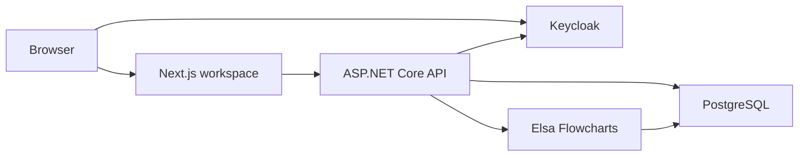

# FlowOps

**A workspace for purchase requests, approvals, and the decisions behind them.**

FlowOps lets each organization publish its own purchase approval workflow. Employees submit requests, managers and finance reviewers act on assigned approvals, and requesters can see which steps ran. Every request keeps the workflow version it started with.

[Quick start](#quick-start) · [Try a workflow](#try-a-workflow) · [Architecture](#architecture) · [Verification](#verification)

## What works today

| Area | Capabilities |
| --- | --- |
| Organizations | Keycloak sign-in, isolated workspaces, email-bound invitation links, roles, and approver assignment |
| Workflow catalog | Drafts, name search, status filters, duplication, publication, immutable versions, and archiving |
| Visual editor | Drag and connect steps, branch on manager decisions or a finance threshold, and add in-app notifications |
| Purchase approvals | Durable manager and finance tasks, decision history, and a canvas showing the Elsa steps that ran |

## Quick start

Install Node.js 24+, .NET SDK 11.0.100 or a newer patch in that feature band, PowerShell, and Docker with Compose. Run these commands from the repository root. Use `npm.cmd` in Windows PowerShell if its execution policy blocks `npm.ps1`.

```powershell
./infrastructure/dev.ps1 init
docker compose up -d --wait
npm --prefix apps/web ci --ignore-scripts
```

Start the API and web app in separate terminals.

```powershell
./infrastructure/dev.ps1 api
./infrastructure/dev.ps1 web
```

Open [localhost:3000](http://localhost:3000). The setup script generates local credentials in `.env`, and the API applies PostgreSQL migrations on startup.

## Try a workflow

1. Sign in as `employee` with `FLOWOPS_DEV_PASSWORD` from your local `.env`. Open **Northstar Operations** and submit a purchase request.
2. Sign in as `manager` in a separate browser session and approve the request in **Approval center**. For purchases over USD 5,000 in the seeded organization, sign in as `finance` to make the second decision.
3. To build and publish a workflow, sign in as `finance` and open **Juniper Labs**, where that account is an owner. Invite a member with a verified Keycloak email and assign a manager in **Organization settings**. Open **Workflows** to edit and publish the graph. Members with a manager can submit a request from its published entry.
4. Open a request created from a compiled graph to inspect its pinned version and node states.

Stop the web and API with Ctrl+C. Run `docker compose --profile integrations stop` to stop the local containers. The optional `./infrastructure/dev.ps1 integrations` command starts n8n, Mailpit, and S3-compatible SeaweedFS. n8n is available for local operator setup.

## Architecture



Next.js renders the workspace and forwards authenticated API calls. The API checks organization membership and purchase access. PostgreSQL stores requests, published versions, and durable approval commands. Elsa executes the compiled graph and resumes human approvals from stored bookmarks.

| Path | Contents |
| --- | --- |
| [apps/web](apps/web) | Next.js workspace, React Flow editor, and Playwright tests |
| [backend](backend) | .NET 11 API, Elsa activities, and PostgreSQL migrations |
| [infrastructure](infrastructure) | Local setup scripts and Keycloak realm |
| [docs](docs) | API, workflow, testing, and deployment notes |

## Verification

With the local stack running, install Chromium and run the browser suite.

```powershell
npm --prefix apps/web exec -- playwright install chromium
./infrastructure/dev.ps1 test
```

The tests cover tenant access, purchase approval and rejection, concurrent decisions, invitations, and published graph execution. See [testing](docs/TESTING.md) and the [implementation checklist](TASKS.md) for verified milestones and remaining work.

Project instructions live in [AGENTS.md](AGENTS.md). Impeccable, Hallmark, and Unslop are installed at project scope. Review and approve the Impeccable hook in Codex with `/hooks` to enable it locally.
