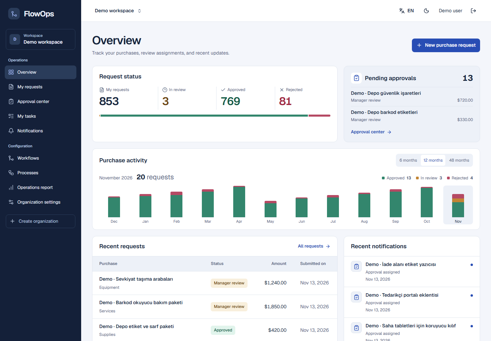
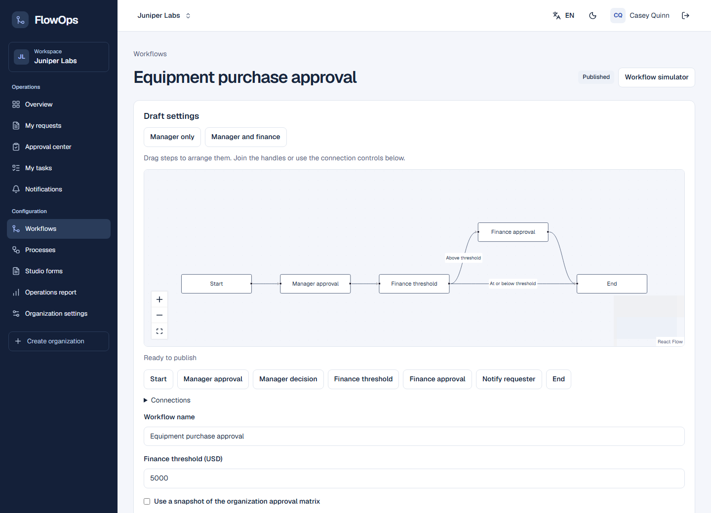
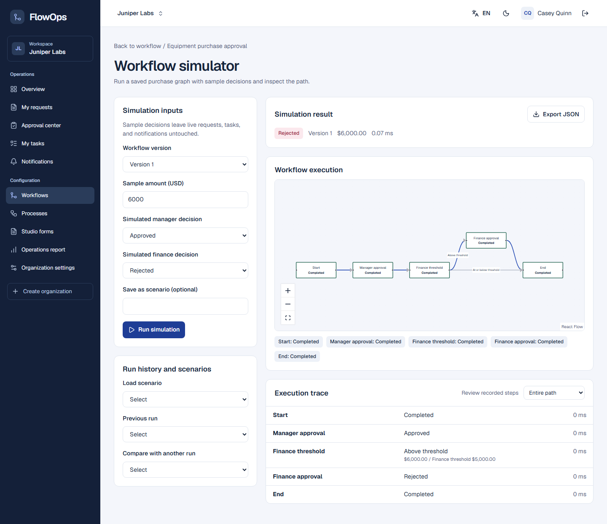
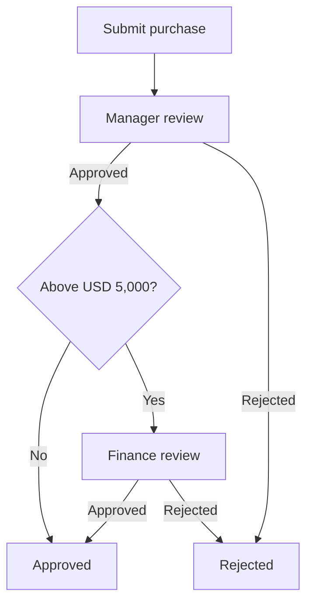
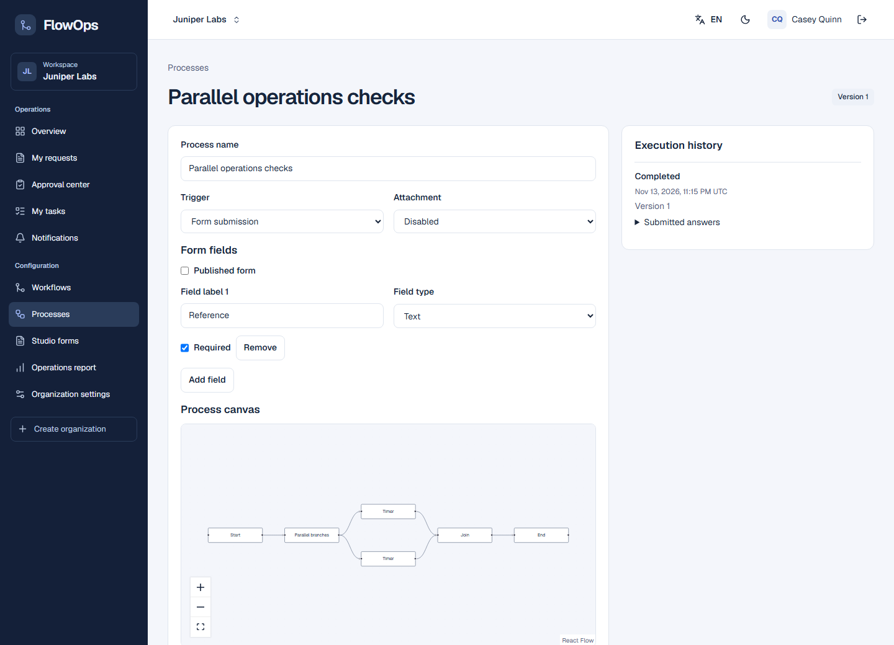
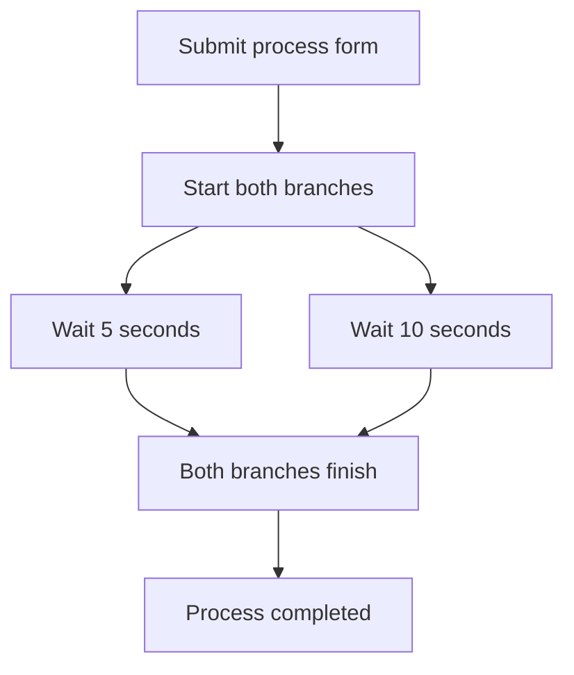
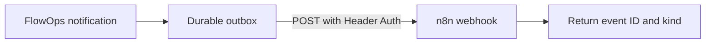
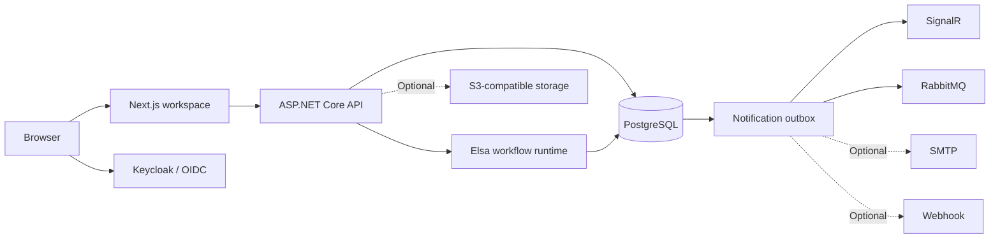

# FlowOps

**Run purchase approvals and internal processes in one workspace.**

FlowOps gives requesters a place to submit and track work, reviewers a queue of assigned decisions, and administrators a record of the rules and actions behind each outcome. The workspace is available in English and Turkish, with light and dark themes.

[Quick start](#quick-start) · [Try the demo](#try-the-demo) · [Example workflows](#example-workflows) · [Architecture](#architecture) · [Costs and licensing](#costs-and-licensing)

[](https://github.com/cevikburak1/flowops/actions/workflows/verify.yml)



*The dashboard shown above uses synthetic purchase history.*

## Example workflows

| Try it | What happens |
| --- | --- |
| [Elsa purchase approval JSON](examples/workflows/elsa/purchase-approval.json) | The manager reviews first. With a USD 5,000 threshold, a USD 4,000 purchase skips finance and a USD 6,000 purchase waits for finance approval. |
| [Elsa parallel timers JSON](examples/workflows/elsa/parallel-timers.json) | A form starts two timers together. The run completes when both branches finish. |
| [n8n notification receiver JSON](examples/workflows/n8n/flowops-notification-receiver.json) | An authenticated webhook receives a FlowOps notification and returns its event ID and kind. |

The two Elsa examples are FlowOps drafts. Create and publish them in FlowOps to compile them into Elsa definitions. Import the n8n JSON from the n8n editor, then configure the local webhook credential. [Setup for all three examples](examples/workflows/README.md).

### Purchase approval in Elsa







### Parallel process in Elsa





### Notification delivery to n8n



If webhook delivery fails, the FlowOps outbox schedules a retry. The example receiver only acknowledges delivery. The purchase decision and its audit history stay in FlowOps.

## What you can do

| Area | Capabilities |
| --- | --- |
| **Purchase approvals** | Submit requests with amounts and priorities, route to a manager or team lead, and send qualifying purchases to finance. Reviewers get due dates and a decision history. |
| **Workflow catalog** | Edit graphs on a drag-and-drop canvas, publish immutable versions, and inspect the execution attached to a purchase. |
| **Workflow Studio 2.0** | Compare isolated simulation runs, publish reusable forms, configure approval matrices and parallel voting, and track SLA deadlines and escalations. |
| **General processes** | Start runs from a form or authenticated webhook. Combine assignments, parallel branches, durable timers, and HTTP steps with named destinations. Collect text, numbers, dates, and file attachments. |
| **Operations dashboard** | Explore 6-, 12-, or 48-month purchase history, open assigned approvals, and follow notifications. Growing lists use pagination. |
| **Organization administration** | Invite members, organize teams and departments, configure routing and process permissions, and review audit events and delivery retries. |

## Quick start

Install PowerShell 7, Docker with Compose, Node.js 24, and the .NET SDK listed in [backend/global.json](backend/global.json). Then run the following from the repository root.

```powershell
git clone https://github.com/cevikburak1/flowops.git
cd flowops
./infrastructure/dev.ps1 init
docker compose up -d --wait
npm --prefix apps/web ci --ignore-scripts
```

Start each command in its own terminal.

```powershell
./infrastructure/dev.ps1 api
./infrastructure/dev.ps1 web
```

Open [FlowOps](http://localhost:3000). The API applies database migrations and adds two development organizations. The setup script generates a local `.env` with credentials for PostgreSQL, Keycloak, and the demo accounts. Keep this file local.

### Try the demo

Use `FLOWOPS_DEV_PASSWORD` from your local `.env` for the three development accounts. Use separate browser profiles to try multiple roles at once.

| Sign in as | Try this |
| --- | --- |
| `employee` | In **Northstar Operations**, submit a purchase for USD 6,000. |
| `manager` | Open **My tasks** and approve the purchase. |
| `finance` | Complete the finance approval. Switch to **Juniper Labs** to manage workflows and processes or view reports. |

To submit requests in a new organization, assign the requester a manager or a team or department lead. For optional local Mailpit, SeaweedFS, and n8n services, run `./infrastructure/dev.ps1 integrations`. Stop the app terminals with Ctrl+C and the containers with `docker compose --profile integrations stop`.

## Architecture



Next.js uses server-side OIDC sessions. The API resolves organization membership and scopes data access by tenant. Elsa persists execution across human decisions and timers. FlowOps stores a purchase decision together with the command that resumes execution. A transactional outbox tracks notification delivery and retries.

## Costs and licensing

- **Local use** requires no OpenAI API key, paid API subscription, cloud account, or payment setup. Plan labels and limits are application settings. Payment collection and invoicing are outside the current implementation.
- **GitHub** offers free standard Actions runners for public repositories. This repository uses a standard Ubuntu runner for verification. [GitHub Actions billing](https://docs.github.com/en/billing/concepts/product-billing/github-actions)
- **Docker** can run the stack locally. Docker Desktop is free for personal use and other qualifying users under its terms. [Docker Desktop licensing](https://docs.docker.com/subscription-billing/desktop-license/)
- **Optional services** can run locally with Mailpit and SeaweedFS. Managed hosting, SMTP, or object storage may incur provider charges if configured. n8n is optional and has its own terms for internal, personal, or non-commercial use. [n8n license](https://github.com/n8n-io/n8n/blob/master/LICENSE.md)
- **Source availability.** FlowOps currently has no project-wide software license. Third-party development tools retain their own terms. [Third-party notices](docs/THIRD_PARTY.md)

## Verify

With the local stack running, install the test browser and run the acceptance suite.

```powershell
npm --prefix apps/web exec -- playwright install chromium
./infrastructure/dev.ps1 test
```

The GitHub workflow checks lint, types, builds, browser acceptance, backend tests, and container builds. See the [testing guide](docs/TESTING.md) for setup and additional scenarios.

## Documentation

| Guide | Contents |
| --- | --- |
| [Architecture](ARCHITECTURE.md) | Service and tenant boundaries |
| [Workflows](docs/WORKFLOWS.md) | Purchase graphs, process definitions, and execution |
| [API](docs/API.md) | Routes, permissions, and pagination |
| [Deployment](docs/DEPLOYMENT.md) | Runtime settings, integrations, and recovery |
| [Project status](TASKS.md) | Implemented features, verification, and remaining work |
